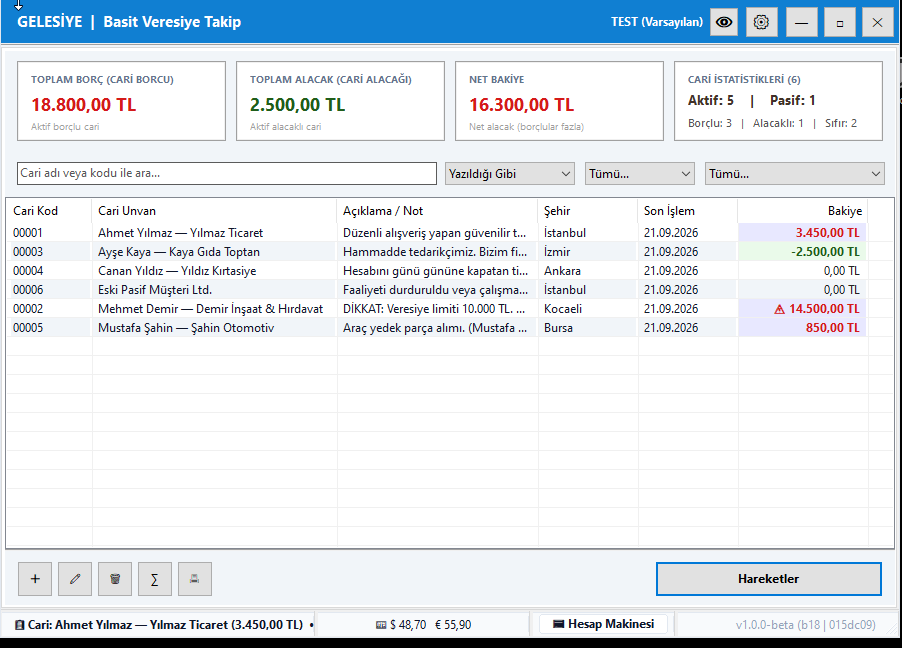
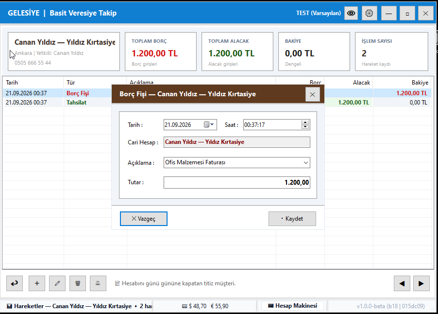

# Gelesiye (WPF Edition) — Modern Veresiye & Cari Takip Sistemi

**Gelesiye**, esnaf, işletme ve serbest meslek sahipleri için tasarlanmış; modern, güvenilir, sade ve hızlı bir veresiye/cari takip yazılımıdır.

En güncel **.NET 10** platformunda, modern **C#**, **WPF (Windows Presentation Foundation)** ve **MVVM (CommunityToolkit.Mvvm)** tasarım mimarisiyle sıfırdan geliştirilmiştir.

---

## 🚀 Hemen İndir ve Kur

- 📦 **Kararlı Kurulum Paketi (Release x64):** [Gelesiye_WPF_Setup_x64.exe](releases/Gelesiye_WPF_Setup_x64.exe) — *Önerilen üretim sürümü (~12.6 MB)*
- 🛠️ **Geliştirici / Test Kurulum Paketi (Debug x64):** [Gelesiye_WPF_Setup_Debug_x64.exe](releases/Gelesiye_WPF_Setup_Debug_x64.exe) — *Hata ayıklama sembolleri içeren sürüm (~12.6 MB)*

> **Varsayılan Giriş Şifresi:** `gel`

---

## 📸 Ekran Görüntüleri

### 1. Ana Ekran (Cari Listesi & Özet Kartlar)


<br>

### 2. Hareketler & Borç / Alacak Fişi Girişi


---

## 🌟 Öne Çıkan Özellikler ve Mimari Yetkinlikler

### 1. Mimari & Teknoloji Yığını
- **.NET 10 & C#:** Modern C# özellikleri, bağımlılık enjeksiyonu (`Microsoft.Extensions.DependencyInjection`) ve asenkron programlama.
- **CommunityToolkit.Mvvm:** `ObservableObject`, `RelayCommand` ve `AsyncRelayCommand` ile saf MVVM ayrımı.
- **Hızlı Veri Erişimi:** Gömülü **SQLite** motoru ve yüksek performanslı **Dapper** mikro-ORM sorgu katmanı.
- **FluentValidation:** Veri girişlerinde güçlü ve kurallı model doğrulama altyapısı.

### 2. İşlevsel Fonksiyonlar
- **Hızlı Fiş Girişi & Standart Kısayollar:**
  - `F5`: Borç Dekontu / Fişi Ekle
  - `F6`: Tahsilat Ekle (Alacak sütunu)
  - `F7`: Alacak Dekontu Ekle
  - `F8`: Ödeme Ekle (Borç sütunu)
  - `F4 / Çift Tık`: Seçili fişi veya cariyi düzenle
- **Sağ Tık Bağlam Menüleri:** Cari ve hareket tablolarında hızlı işlem menüleri.
- **Baskı & Raporlama Motoru:** Makbuz, dekont ve cari hesap ekstresi yazdırma desteği (`PrintService.cs`).
- **Canlı TCMB Döviz Kurları:** Türkiye Cumhuriyet Merkez Bankası günlük kurlarını arkaplanda asenkron olarak sorgulayan kur servisi (`DovizKuruService.cs`).
- **Modern Arayüz & Tema:** Slate-100 tabanlı aydınlık/karanlık mod desteği (`AppTheme.cs`).
- **Çoklu Dil (Lokalizasyon):** Dinamik Türkçe ve İngilizce arayüz desteği (`LocalizationManager.cs`).
- **81 İl & 973 İlçe Veritabanı:** Türkiye il ve ilçe verilerinin otomatik yüklenmesi.

---

## 📂 Dizin Yapısı

```
Gelesiye-WPF/
├── Assets/          # Uygulama ikonları ve görsel varlıklar
├── Common/          # Sabitler, temalar ve ortak tip tanımları
├── Converters/      # XAML veri dönüştürücüleri
├── Data/            # SQLite veritabanı ve Repository sınıfları (Dapper)
├── docs/            # Ekran görüntüleri ve kılavuz dokümanları
├── Domain/          # Saf iş varlıkları (Entities)
├── installer/       # Inno Setup 6 x64 kurulum yapılandırma scripti (.iss)
├── releases/        # Dağıtıma hazır 64-bit kurulum paketleri (.exe)
├── scripts/         # Derleme ve kurulum betikleri (.bat)
│   ├── build.bat        # .NET 10 Release derleme betiği
│   └── build_setup.bat  # Inno Setup kurulum paketi üretme betiği
├── Services/        # Döviz kuru, yazdırma, yedekleme ve dil servisleri
├── Validators/      # FluentValidation model doğrulayıcıları
├── ViewModels/      # MVVM ViewModel sınıfları
└── Views/           # WPF XAML pencereleri ve diyaloglar
```

---

## 🛠️ Derleme ve Kurulum

### Gereksinimler
- **SDK:** .NET 10 SDK (veya Visual Studio 2026/VS Code)
- **Kurulum Aracı (Opsiyonel):** Inno Setup 6

### 1. Uygulamayı Derleme
```cmd
scripts\build.bat
```

### 2. Kurulum Paketi Üretme (Inno Setup x64)
```cmd
scripts\build_setup.bat
```
Çıktı kurulum paketi `releases\Gelesiye_WPF_Setup_x64.exe` olarak üretilir.

---

## 📄 Lisans

Bu proje kişisel, eğitim ve şirket içi kullanım için ücretsizdir. Ticari amaçla satışı veya ücretli dağıtımı yapılamaz. Detaylar için [LICENSE](LICENSE) dosyasına bakabilirsiniz.
