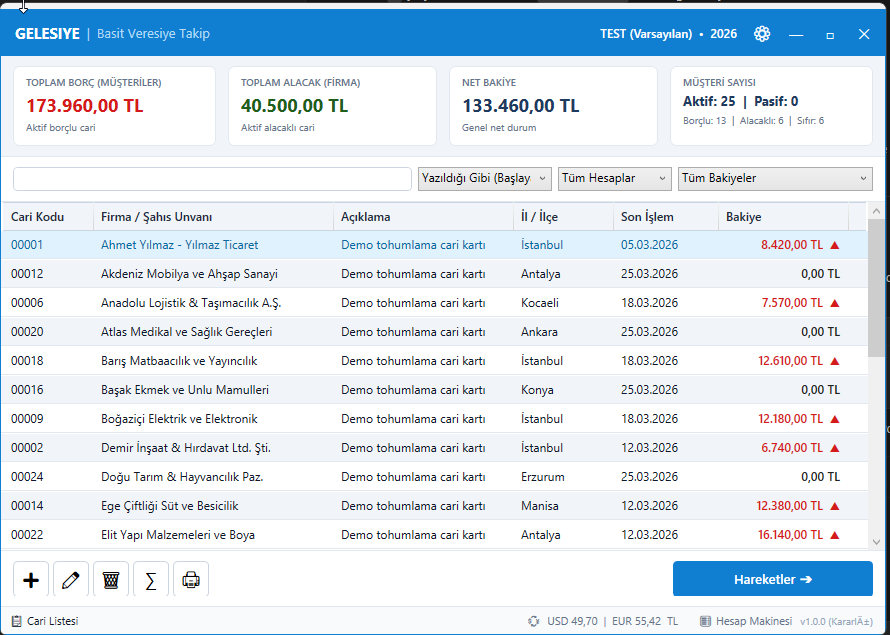
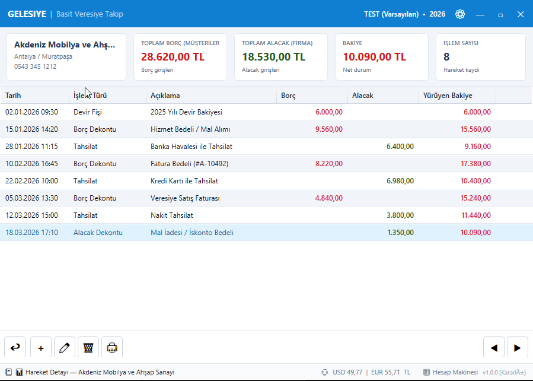
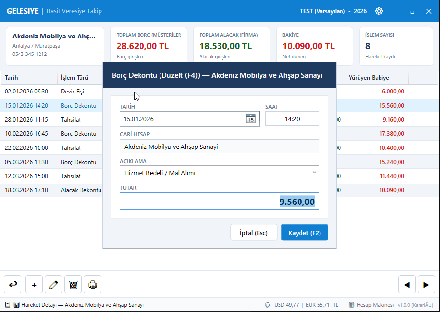
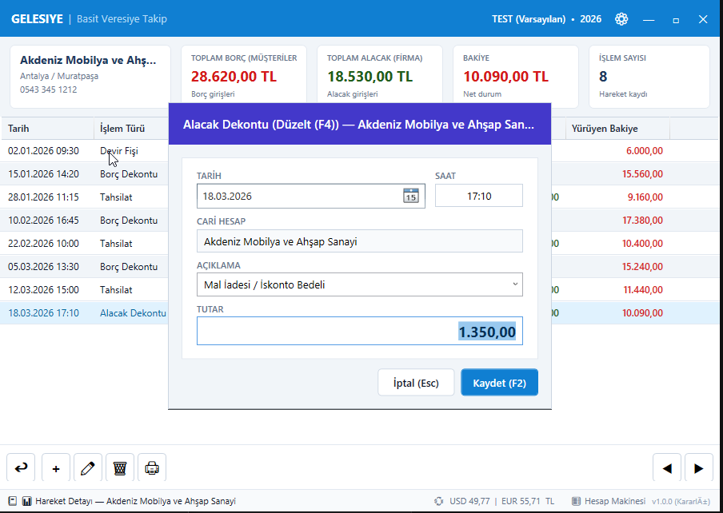
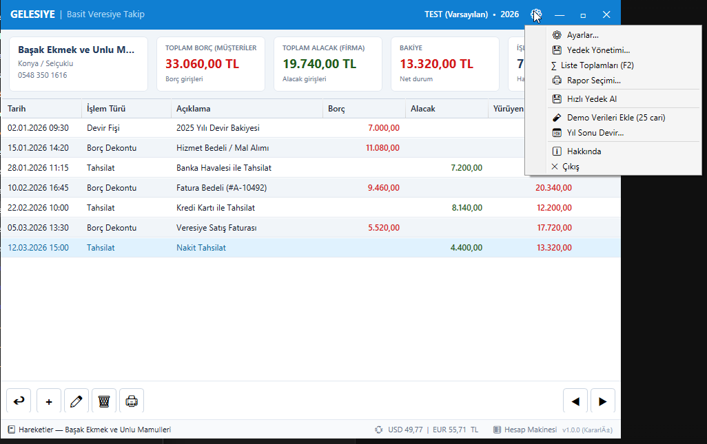
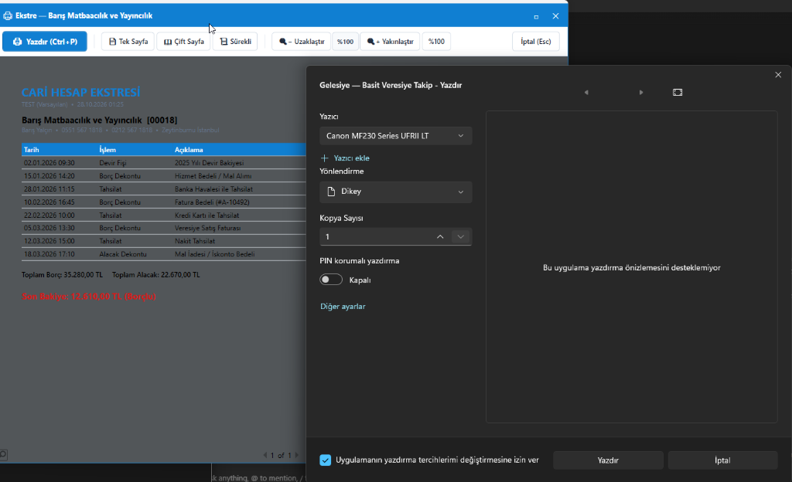
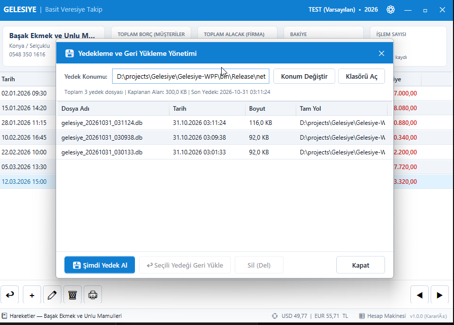
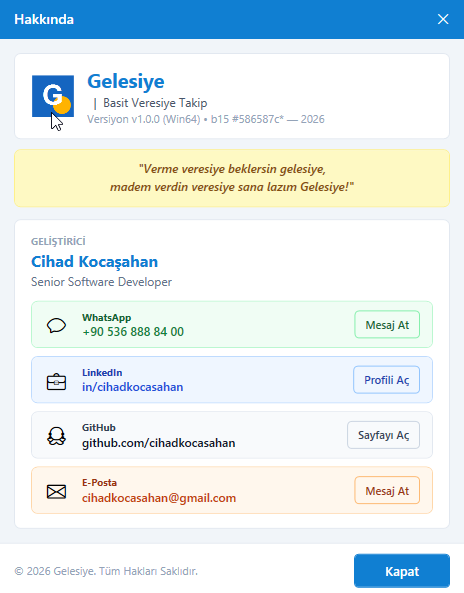

# Gelesiye — Basit Veresiye Takip | Kullanım Kılavuzu

> *"Verme veresiye beklersin gelesiye, madem verdin veresiye sana lazım Gelesiye!"*

**Gelesiye**, karmaşık ve hantal muhasebe programlarıyla vakit kaybetmeden esnaf, perakendeci, toptancı ve serbest çalışanların borç-alacak kayıtlarını en pratik, hızlı ve güvenli şekilde takip edebilmesi için modern .NET 10 ve WPF teknolojisiyle tasarlanmıştır.

---

## 📑 İçindekiler
1. [Giriş ve Güvenlik](#1-giriş-ve-güvenlik)
2. [Ana Ekran ve Finansal Özet Kartları](#2-ana-ekran-ve-finansal-özet-kartları)
3. [Akıllı Arama ve Çift Modlu Filtreleme](#3-akıllı-arama-ve-çift-modlu-filtreleme)
4. [Cari Hesap Kartı Tanımlama ve Yönetimi](#4-cari-hesap-kartı-tanımlama-ve-yönetimi)
5. [Cari Hareketler ve Seri Fiş Girişi](#5-cari-hareketler-ve-seri-fiş-girişi)
6. [Yazdırma, Ekstre ve Raporlama Sistemi](#6-yazdırma-ekstre-ve-raporlama-sistemi)
7. [Veri Güvenliği, Otomatik Yedekleme ve Devir](#7-veri-güvenliği-otomatik-yedekleme-ve-devir)
8. [Program ve Firma Ayarları](#8-program-ve-firma-ayarları)
9. [Hakkında ve Lisans Bilgileri](#9-hakkında-ve-lisans-bilgileri)
10. [Klavye Kısayolları Referans Tablosu](#10-klavye-kısayolları-referans-tablosu)

---

## 1. Giriş ve Güvenlik

Gelesiye açılışında verilerinizin güvenliği için şifre koruma penceresi sunulur.

- **Varsayılan Giriş Şifresi:** `gel` *(Küçük harflerle)*
- **Şifre Değiştirme:** Ayarlar (⚙) menüsünden istediğiniz zaman değiştirebilirsiniz.
- **Güvenlik Kilidi:** 3 defa hatalı şifre girildiğinde yetkisiz erişimi engellemek için program otomatik olarak kapanır.

---

## 2. Ana Ekran ve Finansal Özet Kartları

Ana ekran; tüm müşteri listenizi, güncel borç/alacak bakiyelerini ve işletmenizin anlık finansal durumunu tek bakışta görebileceğiniz modern bir gösterge paneli (dashboard) sunar.

### Üst Finansal Özet Kartları
1. **Toplam Borç (Kırmızı):** Müşterilerinizin işletmenize olan toplam borç tutarı ve borçlu müşteri adedi.
2. **Toplam Alacak (Yeşil):** İşletmenizin müşterilere/tedarikçilere olan toplam borcu (alacaklılar).
3. **Net Bakiye (Mavi):** Piyasadan toplam net alacağınız (`Toplam Borç - Toplam Alacak`).
4. **Cari Sayısı:** Sistemde kayıtlı aktif ve pasif müşteri/hesap dağılımı.

---

## 3. Akıllı Arama ve Çift Modlu Filtreleme

Arama çubuğu üzerinden binlerce cari arasında milisaniyeler içinde arama yapabilirsiniz:

- **Arama Modları:**
  - *İçeren:* Aranan harf grubunun unvan veya kodun herhangi bir yerinde geçmesi yeterlidir.
  - *Yazıldığı Gibi:* Kelimenin tam başlangıcına göre eşleşme yapar.
- **Durum Filtresi:** Tümü, Sadece Aktif Hesaplar, Sadece Pasif Hesaplar.
- **Bakiye Filtresi:**
  - *Tümü:* Tüm cariler listelenir.
  - *Borçlular:* Sadece size borcu olan müşteriler.
  - *Alacaklılar:* Sadece alacaklı olan hesaplar.
  - *Bakiyesi Sıfır Olmayanlar:* Hesabı açık olan tüm cariler.
  - *Bakiyesi Sıfır Olanlar:* Borcu/alacağı kalmamış, hesabı kapanmış cariler.
  - *Risk Limitini Aşanlar:* Belirlenen kredi limitini aşan müşteriler.
- **Ayarlar Entegrasyonu:** Ayarlar üzerinden varsayılan filtreleri belirleyebilir ve dilerseniz *"Son kullanılan filtreleri hatırla"* seçeneğini aktif edebilirsiniz.

---

## 4. Cari Hesap Kartı Tanımlama ve Yönetimi

Yeni müşteri tanımlamak için <kbd>F3</kbd> tuşuna basabilir veya alt çubuktaki `➕` butonuna tıklayabilirsiniz.

- **Otomatik Cari Kodu:** Sistem bir sonraki boş cari kodunu otomatik önerir (`C0001`, `C0002` vb.).
- **Zengin İletişim Bilgileri:** Yetkili, Telefon, GSM, Faks, E-posta, Web adresi.
- **81 İl ve İlçe Hiyerarşik Seçimi:** İl seçildiğinde ilgili ilçeler otomatik listelenir.
- **Risk / Kredi Limiti:** Müşteriye özel veresiye limiti tanımlayabilirsiniz. Fiş girişlerinde limit aşılırsa sistem sesli ve görsel onay uyarısı verir.
- **Özel Notlar:** Müşteriye özel hatırlatma ve ticari notlar sekmesi.
- **Doğrulama (Validation):** Hatalı veya mükerrer kayıtlar anında engellenir ve rehberlik sağlanır.

---

## 5. Cari Hareketler ve Seri Fiş Girişi

Bir müşterinin üzerine çift tıklayarak veya <kbd>Enter</kbd> tuşuna basarak müşteri hareket ekstresine geçebilirsiniz.

### Yürüyen Bakiye Sistemi
Her işlem satırında yapılan tahsilat veya borçlandırma anında hesaplanır ve satır bazında **Yürüyen Bakiye** sütununa yansıtılır. Böylece müşterinin o tarihteki borcu anında görülür.

### Seri Fiş Girişi & Kısayol Tuşları
Fareye ihtiyaç duymadan klavye üzerinden anında fiş kesebilirsiniz:

| Kısayol | Fiş Türü | İşlem Açıklaması | Bakiyeye Etkisi |
|:---:|:---|:---|:---:|
| <kbd>F5</kbd> | **Borç Dekontu** | Müşteriye veresiye mal/hizmet verildiğinde | Müşteri borcu artar (+) |
| <kbd>F6</kbd> | **Tahsilat Fişi** | Müşteriden nakit, havale veya kartla ödeme alındığında | Müşteri borcu düşer (-) |
| <kbd>F7</kbd> | **Alacak Dekontu** | İade alınan ürünler veya müşteriye borçlanılan durumlar | Müşteri alacağı artar (-) |
| <kbd>F8</kbd> | **Ödeme Fişi** | Tedarikçiye ödeme yapıldığında veya müşteriye iade ödemesinde | Bakiye dengesi artar (+) |
| <kbd>Alt + ←</kbd> / <kbd>Alt + →</kbd> | **Cari Geçişi** | Listeye dönmeden önceki veya sonraki müşterinin ekstresine hızlı geçiş | Ekran güncellenir |
| <kbd>Esc</kbd> | **Geri Dön** | Hareket sayfasından ana Cari Listesine tek tuşla dönüş | Listeye döner |

### Hızlı İşlem Menüsü & Kısayol Araçları

### Klavye Ergonomisi (Hızlı İşlem)
Fiş kaydedildikten sonra çıkan *"Makbuz yazdırılsın mı?"* onay kutusunda varsayılan seçim **Hayır** butonudur:
- Yazdırmadan devam etmek için <kbd>Enter</kbd> veya <kbd>Esc</kbd> basmanız yeterlidir; anında bir sonraki fişe geçebilirsiniz.
- Yazdırmak isterseniz <kbd>Tab</kbd> veya ok tuşlarıyla **Evet**'e geçip <kbd>Enter</kbd> basabilirsiniz.

---

## 6. Yazdırma, Ekstre ve Raporlama Sistemi

Gelesiye, Windows yazdırma altyapısıyla tam entegre modern bir **Baskı Önizleme Penceresi** sunar.

### Rapor Seçenekleri
- **📑 Ayrıntılı Cari Hesap Ekstresi:** İki tarih arası veya dönemsel olarak müşterinin tüm borç, alacak ve yürüyen bakiye dökümü.
- **📋 Cari Bakiye Özet Listesi:** Tüm müşterilerin borç, alacak ve telefon bilgilerini içeren toplu liste.
- **📊 Genel Hareketler Raporu:** Belirli bir dönemdeki tüm ticari işlemleri kronolojik sırayla gösteren muhasebe raporu.
- **🧾 Fiş Makbuzu:** Tahsilat veya ödeme anında müşteriye verilmek üzere hazırlanan resmi makbuz çıktısı.

### Önizleme Ekranı Özellikleri
- **Üst Eylem Çubuğunda `🖨 Yazdır (Ctrl+P)` Butonu:** Doğrudan sistem yazıcısını tetikler.
- **Sayfa Düzeni Modları:** Tek sayfa, çift sayfa yan yana veya sürekli dikey kaydırma.
- **Yakınlaştırma (Zoom):** %50'den %300'e kadar yakınlaştırma ve tek tıkla %100 sıfırlama.

---

## 7. Veri Güvenliği, Otomatik Yedekleme ve Devir

Ticari verilerinizin güvenliği her şeyden önce gelir. Gelesiye çok katmanlı bir yedekleme mekanizmasına sahiptir.

1. **Hızlı Yedek Al:** Menüden tek tıkla o anki veritabanının zaman damgalı kopyasını oluşturur (`gelesiye_backup_YYYYMMDD_HHmmss.db`).
2. **Otomatik Yedekleme:** Ayarlar menüsünden *"Her program açılışında"* veya *"Günde bir kez"* otomatik yedekleme tanımlayabilirsiniz.
3. **Yedekten Geri Yükleme:** İstediğiniz geçmiş bir yedeği seçerek tek tıkla sistemi o tarihteki durumuna geri döndürebilirsiniz.
4. **Yıl Sonu Devir:** Yıl sonunda eski dönemin bakiyelerini otomatik devir fişi olarak yeni yıla aktarabilirsiniz.

---

## 8. Program ve Firma Ayarları

Ayarlar ekranından (<kbd>⚙</kbd>) işletmenize özel yapılandırmaları özelleştirebilirsiniz.

- **Firma Bilgileri:** Unvan, adres, vergi dairesi/no, telefon ve yetkili bilgileri (tüm rapor ve makbuz başlıklarına otomatik basılır).
- **Para Birimi:** TL, USD, EUR veya dilediğiniz para birimi sembolü.
- **Çoklu Dil (i18n):** Türkçe (`tr-TR`) veya İngilizce (`en-US`) arayüz seçimi.
- **Görünüm Seçenekleri:** Satır çizgileri (Zebra deseni) ve pencere kapatma eylemleri.
- **Açıklama Şablonları:** Sık kullandığınız fiş açıklamalarını kategoriye göre kaydedip fiş keserken tek tıkla seçebilme.

---

## 9. Hakkında ve Lisans Bilgileri

Gelesiye, şeffaf ve güvenilir mimariyle geliştirilmiş olup Hakkında penceresinden sürüm ve lisans detaylarını inceleyebilirsiniz.

---

## 10. Klavye Kısayolları Referans Tablosu

| Tuş | Konum | İşlem |
|:---:|:---|:---|
| <kbd>F1</kbd> | Genel | Kullanım Kılavuzu & Yardım Dokümanı |
| <kbd>F2</kbd> | Cari Listesi | Liste Finansal Toplamları Özeti (∑) |
| <kbd>F3</kbd> | Cari Listesi | Yeni Cari Kartı Ekle (➕) |
| <kbd>F4</kbd> | Cari / Hareket | Seçili Kaydı Düzenle (✏) |
| <kbd>Del</kbd> | Cari / Hareket | Seçili Kaydı Sil (🗑) |
| <kbd>Enter</kbd> | Cari Listesi | Seçili Carinin Hareket Ekstresine Geçiş |
| <kbd>F5</kbd> | Hareketler | Borç Dekontu Kes |
| <kbd>F6</kbd> | Hareketler | Tahsilat Fişi Kes |
| <kbd>F7</kbd> | Hareketler | Alacak Dekontu Kes |
| <kbd>F8</kbd> | Hareketler | Ödeme Fişi Kes |
| <kbd>Ctrl + P</kbd> | Genel / Rapor | Rapor Seçimi & Yazdırma Ekranı |
| <kbd>Alt + ←</kbd> | Hareketler | Bir Önceki Cari Hesaba Geç |
| <kbd>Alt + →</kbd> | Hareketler | Bir Sonraki Cari Hesaba Geç |
| <kbd>Esc</kbd> | Hareketler / Diyalog | Listeye Geri Dön / Pencereyi Kapat |
